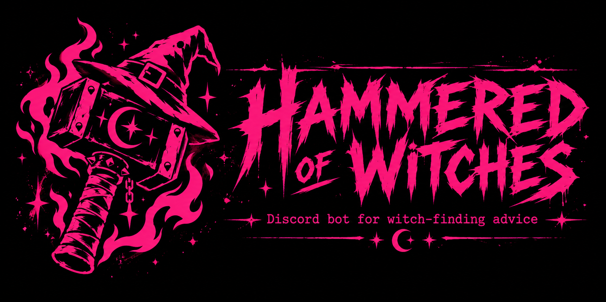

<p align="center"></p>

# Hammered of Witches

A Discord bot of witch-finding advice from the *Malleus Maleficarum* (1486), "the Hammer of Witches", which reads
like someone hammered wrote it. Quotes come from Montague Summers' 1928 translation (public domain), and each one
links to its page in the scanned book.

It grew out of [ktdi](https://github.com/TheScottBot/ktdi)'s `/hammeredofwitches`, which offers 45 tips picked by
hand, with the ugly parts cut out for everyone. This bot keeps the **whole book**, about 2,000 passages, and lets
**each server choose** what to leave out: the stolen-member lore can stay while the misogyny, the torture or the
antisemitism goes.

**[Add it to your server](https://discord.com/oauth2/authorize?client_id=1561092587912429568&permissions=18432&integration_type=0&scope=bot+applications.commands)**
· [Website](https://thescottbot.github.io/Hammered-of-Witches/)
· [Terms of Service](https://thescottbot.github.io/Hammered-of-Witches/terms.html)
· [Privacy Policy](https://thescottbot.github.io/Hammered-of-Witches/privacy.html)

## Commands

| Command | What it does |
|---|---|
| `/hammered [about]` | A random passage, or one that mentions something: `about: milk`, `about: hail`, `about: ointment` |
| `/accuse @someone` | The Malleus's "evidence" that someone is a witch (they're named, not pinged) |
| `/setup show` | This server's filters, and how many passages they allow |
| `/setup preset` | Every filter at once: 🕊️ Tame, ⚖️ Tasteful (the default), 🌶️ Spicy, 🔥 Unabridged |
| `/setup <category> level:` | One filter: **off** (none of it), **mild** (passing mentions), **full** (anything) |
| `/setup hide` / `unhide` | Hide one passage that slipped through, by the `#id` in its footer |
| `/setup reset` | Back to the default, with nothing hidden |
| `/help` | The above, in Discord |

`/setup` needs **Manage Server**. A server can change that under Server Settings → Integrations, and its replies
are only visible to whoever ran it.

### Filter categories

| `/setup …` | Covers |
|---|---|
| `misogyny` | The book's contempt for women: weaker, lustful, liars, more prone to witchcraft |
| `faiths` | Contempt for Jews, Muslims ("Saracens", "Turks"), pagans and other peoples or faiths |
| `lgbt` | Sodomy, "vice against nature", hermaphrodites, sex changes. `/setup lgbt level:off` makes the bot LGBTQ+-friendly |
| `sex` | Copulating with devils, incubi and succubi, stolen "members", impotence spells |
| `gore` | Torture, burning and execution (mild is punishment in passing) |
| `children` | Witch-midwives and harm to children |
| `animals` | Bewitched, killed or maimed animals |
| `suicide` | People driven to kill themselves |

| Preset | misogyny | faiths | lgbt | sex | gore | children | animals | suicide |
|---|---|---|---|---|---|---|---|---|
| 🕊️ Tame | off | off | off | off | off | off | off | off |
| ⚖️ Tasteful (default) | mild | off | off | full | mild | off | mild | off |
| 🌶️ Spicy | full | off | off | full | full | off | full | mild |
| 🔥 Unabridged | full | full | full | full | full | full | full | full |

Passages are tagged by keyword patterns (`hammered/content.py`), not AI, so the tags can be read, tested and fixed.
They lean strict: a wrong tag only hides a passage from a strict server. Some context comes from where a passage
sits in the book: everything in Part I Question 6 (the chapter on women) that mentions women is at least mild
misogyny, and everything in the torture questions is at least mild gore.

## Running it

1. Create an application at the [Discord Developer Portal](https://discord.com/developers/applications), add a bot,
   and copy its token. Upload `assets/icon.png` as the app icon. The listing text and tags are in
   [docs/DISCORD_LISTING.md](docs/DISCORD_LISTING.md). No privileged intents are needed, because it only uses slash
   commands and never reads messages.
2. Invite it with the `bot` and `applications.commands` scopes and the **Send Messages** and **Embed Links**
   permissions (18432). For the live bot that's the link above; for your own, swap in your app's ID:
   `https://discord.com/oauth2/authorize?client_id=YOUR_APP_ID&permissions=18432&integration_type=0&scope=bot+applications.commands`
3. Install and run:

   ```bash
   python -m venv .venv
   .venv/bin/pip install -e .        # Windows: .venv\Scripts\pip install -e .
   cp .env.example .env              # then put DISCORD_TOKEN in it
   .venv/bin/python bot.py           # or: python -m hammered, or: hammered
   ```

Slash commands are registered globally, so they can take up to an hour to show up the first time. While testing,
set `GUILD_IDS` in `.env` to your test server(s) to have them appear instantly. Use a separate test bot with
`.env.dev` and `python bot.py --dev`, so you never run two copies on one token.

Each server's filters are kept in `hammered.db` (SQLite) next to `bot.py`. Set `DB_PATH` to move it.

## Website

The site, with the Terms of Service and Privacy Policy that Discord asks for, is plain HTML in `docs/`, served by
GitHub Pages: Settings → Pages → Deploy from a branch → `main`, folder `/docs`. The privacy policy promises the bot
stores nothing about users, so keep it true: no user IDs or names in the database or the logs.

## Tests

```bash
pip install -e ".[dev]"
python -m pytest
```

The tests check the tagging against known passages, that a Tame server never sees anything from ktdi's grim list
(torture, execution, harm to children...), that every preset still leaves plenty to say, the data's tidiness, the
commands, and that everything registers within Discord's limits.

## Where the text comes from

`hammered/data/malleus.json` is built by `python -m hammered.tools.malleus_build` (needs `pip install -e ".[build]"`)
from archive.org's OCR of two scans of the 1928 edition: the
[Wellcome Library's](https://archive.org/details/b3136245x), and the
[one ktdi links to](https://archive.org/details/bf-1569-a-2-i-5-1928), used for sentences the first scan's OCR
garbled. Summers' introduction and footnotes are left out, along with any sentence with a word that isn't a real
one (OCR debris). ktdi's 45 hand-corrected tips (`hammered/data/picked.json`) replace the OCR's versions of the same
passages. Section titles are in `hammered/data/sections.json`.

Random picks favour the lore and the tales (cows, hail, ointments, "a certain woman in the town of...") over the
scholastic argument, but every passage can come up, and `about:` searches all of them.

The *Malleus* is a manual for persecuting people, mostly women, that helped get many of them killed. This bot quotes
it to laugh at it, not with it.
